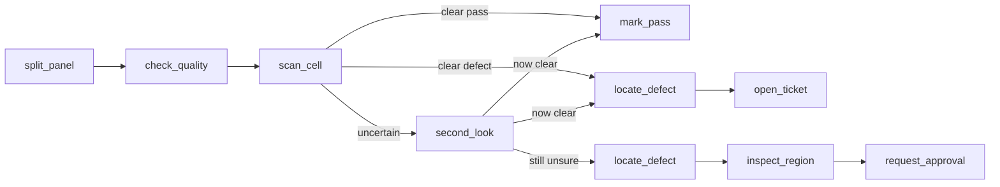
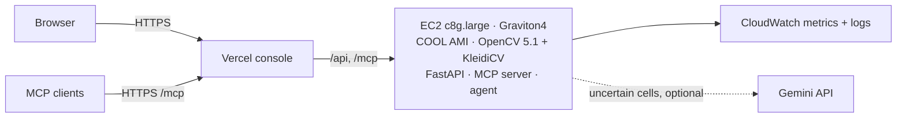

# InspectorMCP

**An agent that inspects solar cells.** It scans every cell, takes a closer look when it isn't sure, then opens a repair ticket or asks a person. It is built on **OpenCV 5 (COOL) on AWS Graviton**, and every tool is exposed over **MCP**.

- **Live console:** <https://inspector-mcp.vercel.app>
- **MCP endpoint:** `https://inspector-mcp.vercel.app/mcp`
- **Technical report:** [docs/REPORT.md](docs/REPORT.md)

Built for the OpenCV AI Competition 2026, powered by AWS (Agentic Vision and Best Use of COOL paths).

| | |
|---|---|
| **87.0%** accuracy | CellNet in OpenCV 5 DNN, 655 held-out cells (AUC 0.91) |
| **88.8%** agent accuracy | on the 89% of cells it decides by itself; the rest go to a human |
| **99 cells/s** | full scan on one c8g.large (Graviton4 + COOL) |
| **3.7×** faster | after profiling every OpenCV op (27 → 99 cells/s) |
| **16%** cheaper than x86 | cost per million cells vs c7i.large |

## How it works



Each box is an OpenCV 5 tool on the MCP server, and what one tool returns decides the next call. Two brains drive the same loop:
- **Rules** (default): auditable, no LLM.
- **Rules + Gemini:** an LLM chooses the tools for uncertain cells and looks at the zoomed images.

Cells that are still uncertain wait in the console for a human decision.



## Repository

```
inspector/
  vision.py      OpenCV 5 tools: rectify/split, quality, cracks, dark areas, zoom, line check
  cnn.py         CellNet inference with cv2.dnn (ONNX), second look, occlusion localisation
  model.py       logistic scorer on the classic OpenCV features (baseline)
  server.py      MCP server - 15 tools (perception + actions)
  agent.py       perception -> decision -> action loop, rule brain, traces
  llm.py         Gemini brain for uncertain cells
  web.py         FastAPI console + live SSE traces + approvals + tickets, mounts /mcp
  telemetry.py   CloudWatch metrics and run logs
  static/        the console (single page)
  cellnet.onnx   trained model (+ cellnet.json: input size, threshold)
scripts/         training, evaluation, benchmarks, cost table, failure cases, trace export
tests/           unit tests (vision) and in-process MCP/agent tests
results/         every number in the report, as JSON (+ example agent traces)
deploy/          setup script and systemd unit for a COOL Graviton instance
web/             Vercel front (static page + rewrites to the instance)
docs/            technical report, failure cases
```

## Run it

**On AWS (as deployed).** Launch an EC2 instance (e.g. `c8g.large`) from the AWS Marketplace AMI **"Cloud Optimized OpenCV For AWS Graviton4"**, open port 8080, then:

```bash
git clone https://github.com/Jennivarl/InspectorMCP.git inspector && cd inspector
bash deploy/setup_server.sh          # venv on COOL's OpenCV 5.1, deps from requirements.lock, ELPV dataset, systemd service
curl localhost:8080/health
```

**Optional:**
- For the Gemini brain, put `GEMINI_API_KEY=...` in `.env`.
- For CloudWatch, attach an instance role allowing `cloudwatch:PutMetricData` (namespace `InspectorMCP`) and `logs:*Log*` on `/inspector/*`.

**Locally (any OS, stock OpenCV 5 wheel)**

```bash
python -m venv .venv && source .venv/bin/activate
pip install -r requirements-baseline.txt -r requirements.txt
git clone --depth 1 https://github.com/zae-bayern/elpv-dataset.git ~/elpv-dataset
uvicorn inspector.web:app --port 8080      # open http://localhost:8080
```

**Connect an MCP client**

```bash
claude mcp add --transport http inspector https://inspector-mcp.vercel.app/mcp
```

## Test and reproduce

```bash
python -m pytest -q tests                                   # 10 tests: vision + MCP/agent loop
D=~/elpv-dataset/src/elpv_dataset/data
python -m scripts.train_eval    --data $D                   # classic features + scorer   -> results/single_pass.json
python -m scripts.train_cnn     --data $D --epochs 12       # CellNet (needs requirements-train.txt) -> inspector/cellnet.onnx
python -m scripts.eval_cnn      --data $D                   # CellNet via cv2.dnn          -> results/cnn.json
python -m scripts.eval_agent    --data $D                   # agent over MCP, 655 cells    -> results/agent_policy.json
python -m scripts.eval_agent    --data $D --brain gemini --uncertain-only   #               -> results/agent_gemini_uncertain.json
python -m scripts.benchmark     --data $D --label cool_g4_a # run once per OpenCV build   -> results/bench_*.json
python -m scripts.op_bench      --label cool_a              # single-op timings            -> results/ops_*.json
python -m scripts.cost_table                                #                              -> results/cost.json
python -m scripts.failure_cases --data $D                   #                              -> docs/failure_cases.png
python -m scripts.export_trace  --gemini-cell cell0181.png  # example traces               -> results/traces/
```

The fixed test split (655 cells, seed 7) is stored in `results/single_pass.json`, and every script reuses it. Files ending in `_v1` are the measurements taken before the profiling-driven optimisation.

## Results

| Held-out 655 cells | Accuracy | Precision | Recall | AUC |
|---|---|---|---|---|
| Classic OpenCV features + logistic | 76.2% | 60.2% | 70.7% | 0.830 |
| **CellNet (OpenCV 5 DNN, 2.3 ms)** | **87.0%** | **87.0%** | 68.8% | **0.907** |

- **Agent (rule brain):** it decides 582 of 655 cells at 88.8% accuracy (11 false alarms, 54 misses) and sends 73 to a human. 34 of those 73 really are defective.
- **Gemini brain on the 79 hardest cells:** human reviews drop 73 → 18, but it is only 59% accurate on what it decides. It stays an optional assistant.

| 24-cell panel, full scan | COOL (OpenCV 5.1) | Stock wheel (5.0) |
|---|---|---|
| Graviton4 c8g.large | 99.3 cells/s · $0.251 / 1M cells | 100.9 cells/s · $0.220 / 1M cells |
| x86 c7i.large | — | 83.2 cells/s · $0.298 / 1M cells |

**COOL vs the stock wheel, single ops on Graviton4:**
- COOL faster: CLAHE 1.48×, Otsu 1.22×, cubic resize 1.16×
- COOL slower: large medianBlur 0.76–0.79×, warpPerspective 0.81×

The full method, failure cases, limitations and responsible-use notes are in the [report](docs/REPORT.md).

## Data and licences

Demo panels and evaluation use the [ELPV dataset](https://github.com/zae-bayern/elpv-dataset) (Buerhop-Lutz et al.; Deitsch et al.), licensed **CC BY-NC-SA 4.0**. The dataset is downloaded at setup and not redistributed here. CellNet starts from torchvision's ImageNet MobileNetV3-Small weights.
