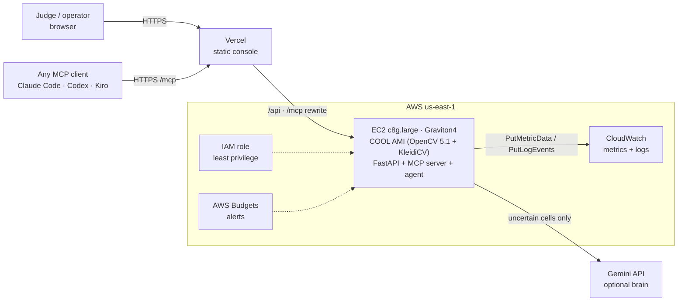
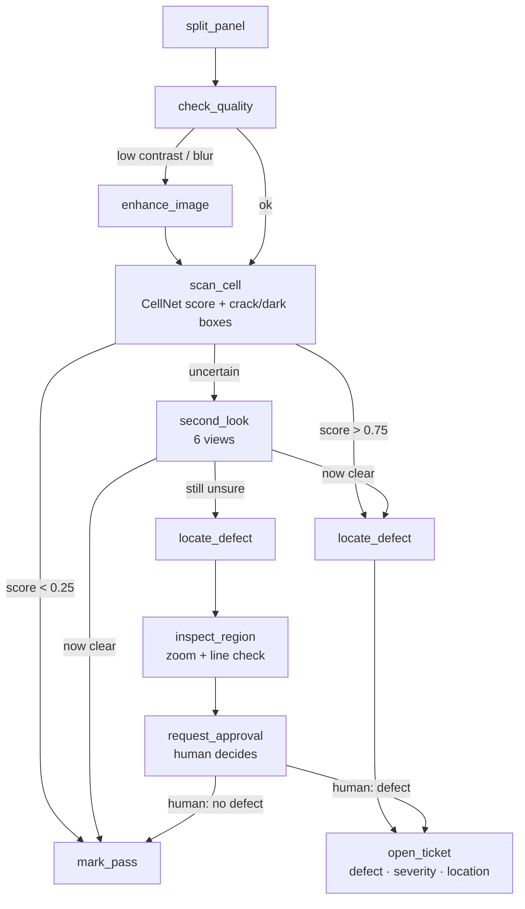
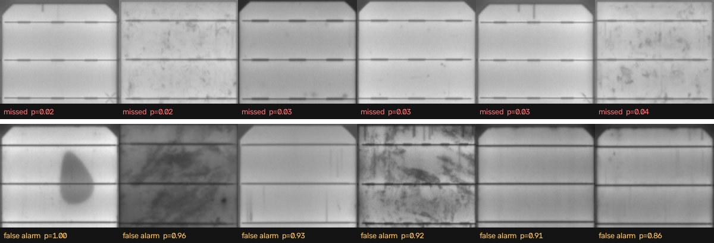

# InspectorMCP — Technical Report

**OpenCV AI Competition 2026, powered by AWS** · Paths: Agentic Vision and Best Use of COOL
Live: <https://inspector-mcp.vercel.app> · MCP endpoint: `https://inspector-mcp.vercel.app/mcp`

---

## 1. Problem and users

Cracked or inactive solar cells lose power and can grow into hot spots. Electroluminescence (EL) imaging makes these defects visible as dark lines and dark areas, but someone still has to look through thousands of cell images per site. Doing that by hand is slow and inconsistent. Automating it fully is also risky, because borderline cells really are hard to call.

**Users:** solar operations and maintenance crews, EL inspection labs, and module manufacturers' quality teams.

**Goal:** an agent that inspects every cell, takes a closer look by itself when it is unsure, and then acts: it passes the cell, opens a repair ticket, or asks a person. Every step must be visible and auditable.

## 2. What we built

| Part | What it does | Where |
|---|---|---|
| OpenCV 5 tools | panel rectify/split, quality gate, crack and dark-area finders, zoom and line check | `inspector/vision.py` |
| CellNet | MobileNetV3-Small fine-tuned on ELPV, exported to ONNX, run with **`cv2.dnn`** | `inspector/cnn.py`, `scripts/train_cnn.py` |
| MCP server | 15 tools over Streamable HTTP (perception and actions) | `inspector/server.py` |
| Agent | perception → decision → action loop over MCP; rule brain plus optional Gemini brain for uncertain cells | `inspector/agent.py`, `inspector/llm.py` |
| Web console | live trace (Server-Sent Events), approvals queue, repair tickets | `inspector/web.py`, `inspector/static/` |
| Telemetry | run metrics and summaries to CloudWatch | `inspector/telemetry.py` |

## 3. Architecture

All OpenCV work, including the neural network, runs on the Graviton instance through COOL. The Vercel layer only serves the static page and forwards `/api` and `/mcp` to the instance, which gives the site a stable HTTPS address. The instance has an IAM role, so there are no AWS keys on disk. The role can only write CloudWatch metrics in the `InspectorMCP` namespace and logs under `/inspector/*`.

## 4. OpenCV 5 implementation

All image work uses OpenCV 5 (COOL build 5.1.0-dev):

- **Panel:** Otsu threshold → largest contour → `approxPolyDP` quad → `warpPerspective`, then a cell grid from smoothed row/column brightness profiles.
- **Background flattening:** median background estimate → `divide`. After profiling (§7) the median runs on a 4×-downscaled copy (`resize INTER_AREA` → `medianBlur` → `resize INTER_LINEAR`).
- **Cell mask:** Otsu → `MORPH_CLOSE` → convex hull of the largest contour. This drops the dark corner cuts but keeps interior dark areas, which are the defects we want to measure.
- **Busbar mask:** median row/column profiles with MAD thresholds. The median means a dark patch is not mistaken for a busbar.
- **Cracks:** `MORPH_BLACKHAT` (ellipse 15) on the flattened image, adaptive threshold, `connectedComponentsWithStats`, `minAreaRect` length/thickness → cracks vs spots.
- **Dark areas:** Gaussian smoothing, a threshold relative to the cell median, then `MORPH_OPEN`.
- **Zoom and line check:** `resize INTER_CUBIC` ×3, denoise, black-hat, Otsu, `HoughLinesP` (longest line), `fitLine` (straightness), contrast.
- **CellNet in OpenCV DNN:** `cv2.dnn.readNetFromONNX` + `blobFromImages`. One forward pass is 2.3 ms, or 1.96 ms per image in batches of 32.
- **Second look:** CellNet on six views in one batch (original, mirror, flip, rotate 180°, CLAHE, denoise). The spread across views is used as a confidence signal.
- **Locate:** occlusion sensitivity. Each patch of a 3×3 grid is greyed out in turn, and the patch whose removal drops the score most is the defect location.

OpenCV 5 API note: `HoughLinesP` and `findNonZero` return `(N, 4)` / `(N, 2)` arrays in 5.x. The code reshapes, so it runs on both 4.x and 5.x layouts.

## 5. The agent (Agentic Vision path)

What the vision tools return decides which tool is called next:
- the quality numbers decide whether to enhance
- the score decides pass, ticket, or a closer look
- the spread across views decides whether to escalate
- the `locate_defect` box becomes the `inspect_region` argument and the ticket location

**Two brains share the same loop and tools:**

- **Rules (default):** fixed and auditable, with no LLM call.
- **Rules + Gemini:** clear cells keep the rule path. For an uncertain cell, a Gemini model gets the scan numbers and a marked-up picture of the cell, chooses its own tool calls (it sees the zoomed images those calls return), and must finish with exactly one action. If it has not decided after 8 turns, the cell goes to a human.

**Human control:** an uncertain cell is never forced into a verdict. `request_approval` puts it in the console queue with the evidence, and the person's answer becomes the final verdict (a ticket or a pass). Actions are limited to recording verdicts and opening tickets. Nothing irreversible happens without a person.

**Observability:** every tool call is recorded with its arguments, the reason for the call, the result and its duration. Traces stream live to the console over SSE. Example traces are saved in `results/traces/`:
- [`panel_policy.json`](../results/traces/panel_policy.json): a full 24-cell panel with the rule brain.
- [`cell_gemini_cell0181.json`](../results/traces/cell_gemini_cell0181.json): an uncertain cracked cell. Gemini calls `second_look`, then `locate_defect`, zooms into the returned hot box with `inspect_region`, and escalates to a human.

## 6. Evaluation

**Data:** the public [ELPV dataset](https://github.com/zae-bayern/elpv-dataset) (2,624 EL cell images, 300×300, mono and poly, CC BY-NC-SA 4.0). A cell counts as defective if its labelled defect probability is ≥ 0.5. The labels are 0, 0.33, 0.67 or 1, so the dataset includes uncertain cases. We hold out a stratified 25% split (655 cells, seed 7) that no model or rule was tuned on. Thresholds were picked on training or validation data only.

| Model (held-out 655 cells) | Accuracy | Precision | Recall | AUC | Time per cell |
|---|---|---|---|---|---|
| Classic OpenCV features + logistic regression | 76.2% | 60.2% | 70.7% | 0.830 | 7.8 ms |
| **CellNet (OpenCV 5 DNN)** | **87.0%** | **87.0%** | 68.8% | **0.907** | **2.3 ms** |

**Agent, through MCP, on all 655 test cells (rule brain)** — `results/agent_policy.json`
- Decided 582 cells (88.9%) by itself, at **88.8% accuracy**: 117 defects caught, 11 false alarms, 54 missed.
- Sent 73 cells (11.1%) to a human. 34 of those are defective, so they really are borderline.
- 3.9 tool calls per cell. All 655 cells took 16 s.

**Gemini brain on the 79 hardest cells** (the ones the rules found uncertain) — `results/agent_gemini_uncertain.json`
- Human reviews fell from 73 to 18 (−75%).
- But Gemini was only **59% accurate** on the 61 cells it decided: 16 false alarms and 9 misses.
- **Conclusion:** the LLM reduces review load but is not reliable enough to replace the human gate on hard cells. Rules stay the default, and Gemini is an optional assistant.

**Failure cases** (`docs/failure_cases.png`, produced by `scripts/failure_cases.py`):

- **Missed (top row):** very small cracks at cell edges and corners. The cell is downscaled to 160 px for CellNet, which makes these hard to see.
- **False alarms (bottom row):** heavily textured poly cells and faint finger marks. One cell labelled healthy has a large dark area (p = 1.00), which is most likely label noise in the dataset.

## 7. AWS deployment and COOL (Best Use of COOL path)

**Deployment**
- EC2 **c8g.large** (Graviton4, 2 vCPU), us-east-1.
- AMI from AWS Marketplace **"Cloud Optimized OpenCV For AWS Graviton4"** (product `prod-k6u24vxijyzvg`, image `ami-033e481a24f94c8cb`).
- **COOL build** (reported live by the `opencv_info` MCP tool):
  - OpenCV 5.1.0-dev, loaded from `/opt/cool/python_3.12/...`
  - Custom HAL: carotene + KleidiCV 0.7.0
  - Arm Performance Libraries 25.07.1
  - SIMD baseline: SVE, NEON, FP16, DOTPROD, BF16
- Runs as a systemd service (`deploy/inspector.service`) behind an Elastic IP.
- One-command setup on a fresh COOL instance: `deploy/setup_server.sh`.

**Method**
- Same instance and same code each time. We switch between COOL and the stock `opencv-python-headless==5.0.0.93` wheel.
- Each benchmark runs twice, alternating builds. Run-to-run spread is about 1% or less.
- Scripts: `scripts/op_bench.py` (single ops), `scripts/benchmark.py` (the real per-cell and per-panel workload), `scripts/cost_table.py`.

**Single operations, COOL vs stock wheel on Graviton4** (`results/ops_*.json`)

| Faster with COOL | | Slower with COOL | |
|---|---|---|---|
| CLAHE | **1.48×** | medianBlur k=61 | 0.76× |
| Otsu threshold | **1.22×** | medianBlur k=31 | 0.79× |
| resize INTER_CUBIC ×3 | **1.16×** | warpPerspective (panel) | 0.81× |
| cvtColor GRAY2BGR | **1.12×** | erode 3×3 | 0.82× |

Note: the stock 5.0 wheel already ships KleidiCV 26.03, which explains why the gap is small.

**Profile-driven optimisation.** The first version leaned on large median blurs, which turned out to be one of COOL's weak spots, and it recomputed the same masks 3–4 times per cell. We moved the median to a 4×-downscaled copy (resizes are cheap) and shared one per-cell `Prep`. Rule accuracy stayed within one point.

| Workload (24-cell panel, full scan) | Before | After |
|---|---|---|
| COOL on Graviton4 | 891 ms (26.9 cells/s) | **242 ms (99.3 cells/s) — 3.7× faster** |
| Stock wheel on Graviton4 | 777 ms (30.9 cells/s) | 238 ms (100.9 cells/s) |

After the optimisation, COOL and the stock wheel are at parity on our end-to-end workload (0.98×). COOL is clearly ahead on the contrast and zoom stages (CLAHE 1.45×, zoom and line check 1.08×), and behind on DNN inference (0.90×).

**Cost per million inspected cells** (on-demand prices; `results/cost.json`)

| Setup | Cells/s | $/hour | $ per 1M cells |
|---|---|---|---|
| Graviton4 c8g.large + COOL | 99.3 | 0.0898 (incl. $0.01 COOL fee) | **0.251** |
| Graviton4 c8g.large + stock wheel | 100.9 | 0.0798 | 0.220 |
| x86 c7i.large (Xeon 8488C) + stock wheel | 83.2 | 0.0892 | 0.298 |

The deployed COOL-on-Graviton setup is **16% cheaper per cell than x86**.

**Reproducibility:** pinned dependencies (`requirements.txt`, full lock `requirements.lock`, `requirements-baseline.txt`, `requirements-train.txt`), fixed seeds and split, and every number in this report comes from a JSON file in `results/` produced by a script in `scripts/`.

## 8. Limitations

- **Recall is 69%.** Small edge cracks get missed. A higher-resolution input or tiled inference would help, at extra cost.
- **Demo panels are tiles of real cells,** not photos of whole installed modules. Perspective rectification is implemented but only tested on clean inputs.
- **Labels are noisy** (some "healthy" cells show clear dark areas), so accuracy above roughly 90% is hard to measure on ELPV.
- **The Gemini brain is slow on the free tier** (about 30 s per hard cell) and is not accurate enough to act alone.
- **Amazon Bedrock (Nova) was blocked** by a new-account restriction during the build, so the optional LLM brain uses the Gemini API instead.
- **Small deployment:** single instance, in-memory store (tickets and approvals reset on restart), one inspection at a time. The Vercel → EC2 hop is plain HTTP.
- **The public MCP endpoint has no authentication.** It is fine for a demo; production needs auth and rate limits.

## 9. Responsible use

- **Human in the loop:** uncertain cells always go to a person. The agent's actions only record verdicts and open tickets, and nothing irreversible is automated.
- **Transparency:** every decision has a stored trace (tools, arguments, reasons, results, timings) and the evidence is shown next to each approval.
- **Data:** ELPV is used under CC BY-NC-SA 4.0 for non-commercial research. No personal data is processed. Only cell images (public dataset) are sent to Gemini, and only for uncertain cells when that brain is chosen.
- **Security:**
  - The IAM role has least privilege. SSH is open only to the developer's address range, and the web port is the only public port.
  - The Gemini key is kept server-side and out of git.
  - Uploads are size- and resolution-limited.
- **Cost guardrails:** AWS Budgets alerts and a small instance. The x86 benchmark box was terminated straight after use.
